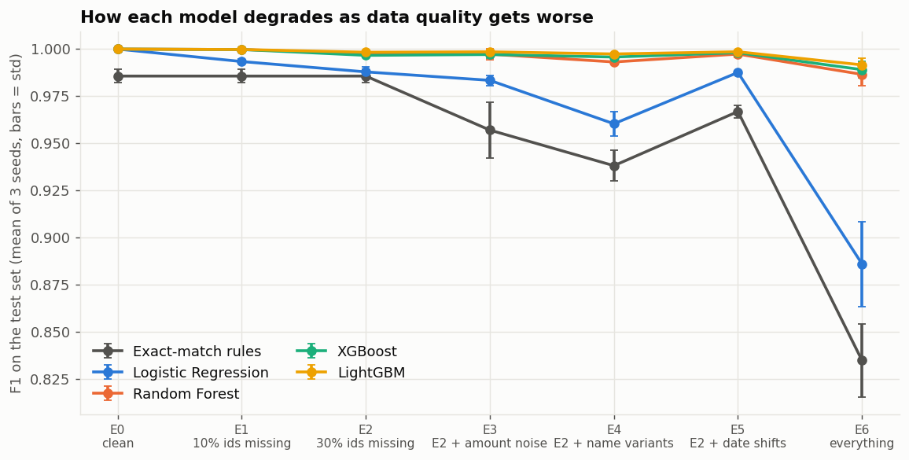
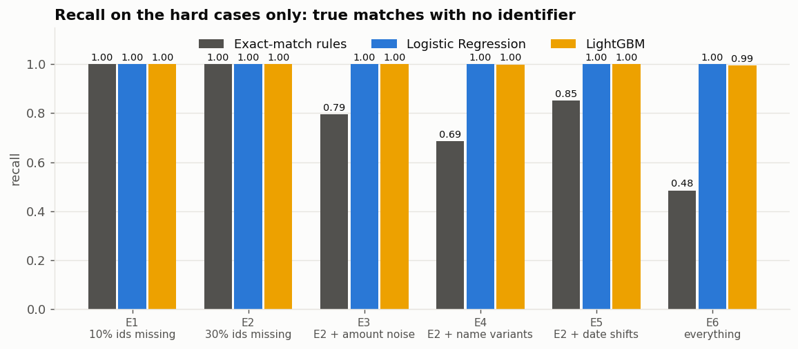
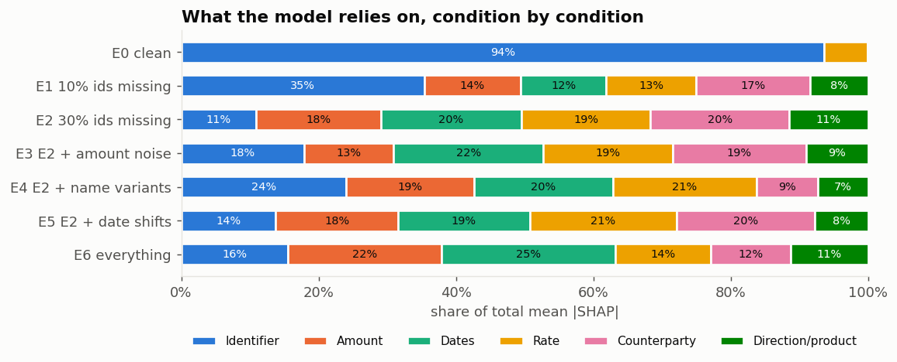
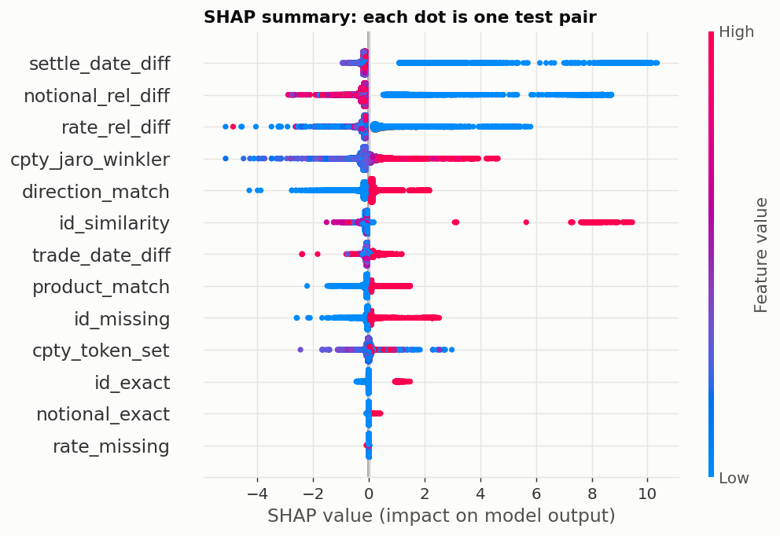
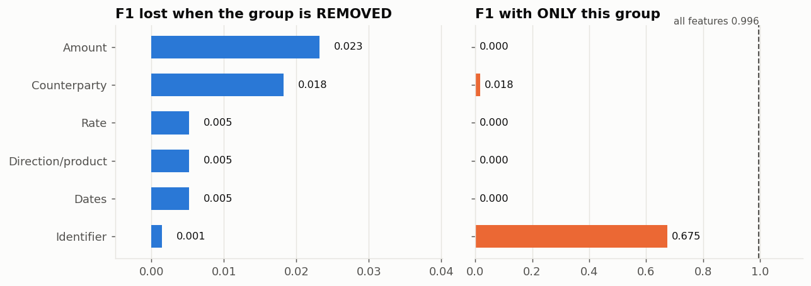
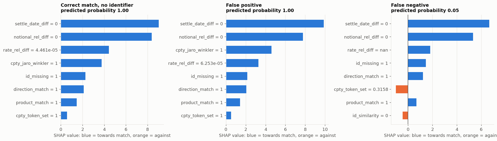
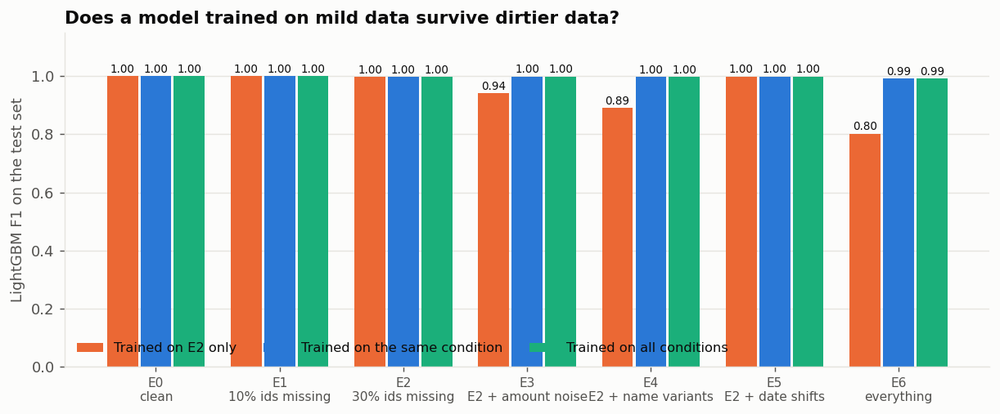
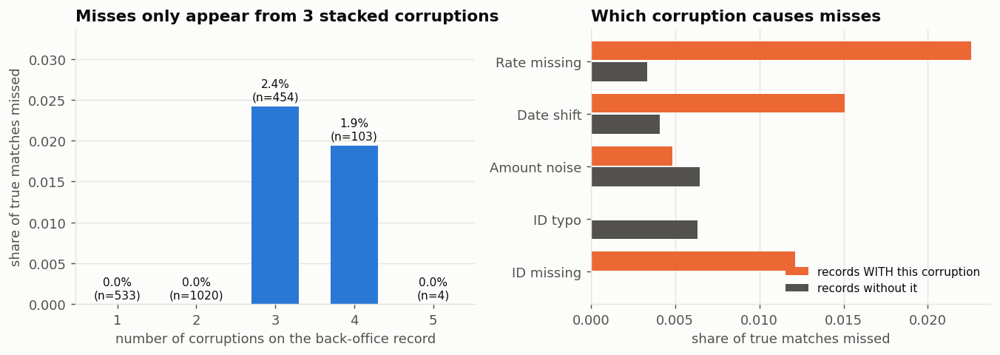
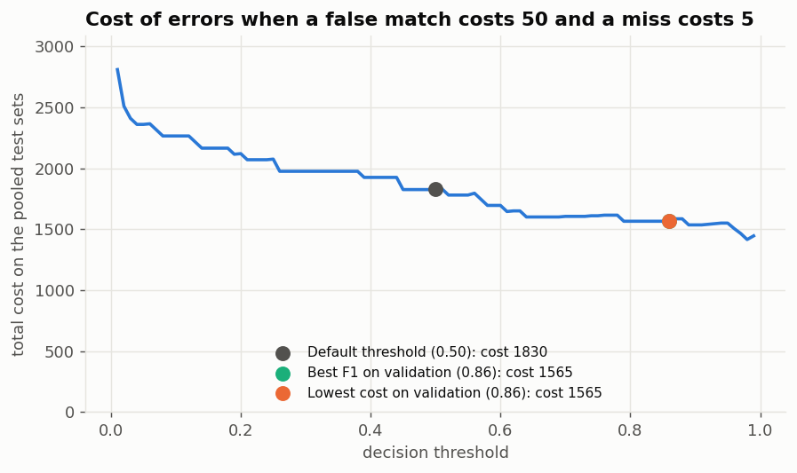
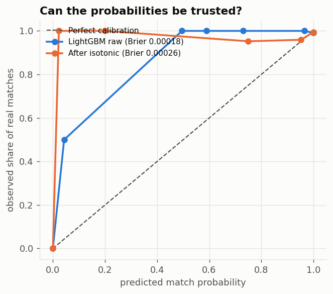

# Explainable ML for Financial Data Reconciliation Under Missing and Noisy Identifiers

A controlled benchmark that asks four questions about matching trade records across two systems:

1. **How fast does each kind of model break** when data quality drops?
2. **Which factors actually carry the match** when identifiers disappear?
3. **Does a model trained on mild data survive dirtier data?**
4. **Where do the remaining errors come from, and can a threshold remove them?**

Every number below is produced by `python -m reconbench.run` and stored in `results/`.

## Summary of findings

| # | Finding | Evidence |
|---|---|---|
| 1 | Tree ensembles are robust; rules and logistic regression are not. With all corruptions at once, LightGBM keeps F1 0.992 while exact-match rules fall to 0.835 and logistic regression to 0.886. | [Section 2](#2-robustness-by-condition) |
| 2 | On records with no identifier, exact-match rules recover only 48.5% of matches under full corruption. LightGBM recovers 99.4%. | [Section 2](#2-robustness-by-condition) |
| 3 | The identifier carries 94% of the model's decision on clean data and 11% once 30% of identifiers are missing. Amount, dates, rate and counterparty take over in roughly equal parts. | [Section 3](#3-which-factors-matter) |
| 4 | Removing the amount features costs the most F1 (−0.023), then counterparty (−0.018). Removing identifiers costs almost nothing (−0.0015), yet identifiers alone reach only F1 0.675. | [Section 3](#3-which-factors-matter) |
| 5 | **A model trained on mild data fails silently on dirty data**: trained with 30% missing ids only, it drops to F1 0.80 under full corruption. Training on a mix of conditions restores 0.992 with no loss on clean data. | [Section 4](#4-train--test-mismatch) |
| 6 | Most remaining false positives cannot be removed by a threshold: 23 of the 36 are scored above 0.99. 60% are look-alike trades (same counterparty, amount, direction, product). | [Section 5](#5-error-analysis) |
| 7 | A three-zone policy (auto-match / analyst review / reject) cuts the error cost by 31% against the default threshold while automating 97% of matches. | [Section 6](#6-thresholds-and-cost) |
| 8 | Negative result: isotonic calibration made the probabilities slightly worse (Brier 0.00018 → 0.00026). | [Section 6](#6-thresholds-and-cost) |

## 1. Setup

**Data.** `reconbench/generate.py` creates 2,500 FX trades over 30 business days in a front-office system (A) and a noisy back-office copy (B), with 5% unmatched records on each side. Every kind of noise has its own knob, and each B record remembers which corruptions it received. The same seed gives the same underlying trades in every condition, so conditions are comparable trade for trade.

| Condition | Corruption applied to system B |
|---|---|
| E0 clean | none (reference formats still differ between systems) |
| E1 | 10% of trade references missing |
| E2 | 30% of trade references missing |
| E3 | E2 + 20% of notionals off by up to ±0.5% |
| E4 | E2 + every counterparty name replaced by a variant (case, legal suffix, short code, truncation, typo) |
| E5 | E2 + 20% of trade dates shifted by 1 to 3 days |
| E6 everything | 50% references missing, 5% reference typos, amount noise, date shifts, name variants, 15% rates missing |

E3 to E5 are built on top of E2 because, with every identifier present, other noise is irrelevant.

**Pipeline.** Blocking (same currency pair and trade dates within 3 days, or same normalised reference) → 13 pairwise features in six groups (identifier, amount, dates, rate, counterparty, direction/product) → classifier. About 175,000 candidate pairs per dataset, 1.35% of them true matches. Blocking keeps 100% of true matches in every condition.

**Models.** Exact-match rules, Logistic Regression, Random Forest, XGBoost, LightGBM. Fixed hyper-parameters, no tuning.

**Evaluation.** Temporal split on the clean system-A trade date: first 70% of days for training, last 30% for testing; a pair is used only if both underlying trades fall in the same part. The split is identical across conditions and no trade appears on both sides (unit-tested). Three seeds; tables report mean ± standard deviation.

## 2. Robustness by condition

F1 on the test set (threshold 0.5):

| Condition | Exact-match rules | Logistic Regression | Random Forest | XGBoost | LightGBM |
|---|---|---|---|---|---|
| E0 clean | 0.986 ± 0.004 | 1.000 ± 0.000 | 1.000 ± 0.000 | 1.000 ± 0.000 | 1.000 ± 0.000 |
| E1 10% ids missing | 0.986 ± 0.004 | 0.993 ± 0.001 | 1.000 ± 0.000 | 1.000 ± 0.000 | 1.000 ± 0.000 |
| E2 30% ids missing | 0.986 ± 0.004 | 0.988 ± 0.002 | 0.998 ± 0.001 | 0.997 ± 0.001 | 0.998 ± 0.000 |
| E3 E2 + amount noise | 0.957 ± 0.015 | 0.983 ± 0.003 | 0.997 ± 0.003 | 0.997 ± 0.002 | 0.999 ± 0.001 |
| E4 E2 + name variants | 0.938 ± 0.008 | 0.960 ± 0.007 | 0.993 ± 0.001 | 0.996 ± 0.001 | 0.997 ± 0.001 |
| E5 E2 + date shifts | 0.967 ± 0.003 | 0.988 ± 0.001 | 0.997 ± 0.002 | 0.998 ± 0.001 | 0.999 ± 0.001 |
| E6 everything | 0.835 ± 0.019 | 0.886 ± 0.023 | 0.987 ± 0.006 | 0.989 ± 0.004 | 0.992 ± 0.003 |



- The three tree ensembles are within one standard deviation of each other everywhere. The benchmark does not separate them.
- Missing identifiers alone (E1, E2) do not hurt the rules: when nothing else is wrong, "all key fields equal" still fires. The rules break when a second problem is added, and name variants hurt them most.
- Rules are below 1.0 even on clean data (0.986) because "all key fields equal" also fires on look-alike trades.
- Logistic regression keeps recall near 1.0 but loses precision: it cannot express "reference missing **and** everything else agrees".

Recall restricted to true matches whose reference is missing:



## 3. Which factors matter

**SHAP, condition by condition.** One LightGBM per condition; share of total mean |SHAP| carried by each feature group on the test set.



The model shifts its reliance as soon as the identifier stops being dependable: 94% → 35% → 11% from E0 to E2. When names become unreliable (E4) the counterparty share halves (20% → 9%) and the identifier share rises again (24%).

**SHAP summary under full corruption (E6).** Each dot is one test pair; colour is the feature value.



Zero settlement-date gap, zero notional difference and a tiny rate difference push strongly towards a match. A high reference similarity is the single strongest push when it is available.

**Ablation under E6.** SHAP says what the model *uses*; ablation says what it *needs*. LightGBM retrained without each group, and with each group alone:

| Feature group | F1 without it | F1 lost | F1 with only it |
|---|---|---|---|
| All features | 0.996 | – | 0.996 |
| Amount | 0.972 | 0.023 | 0.000 |
| Counterparty | 0.977 | 0.018 | 0.018 |
| Dates | 0.990 | 0.005 | 0.000 |
| Rate | 0.990 | 0.005 | 0.000 |
| Direction/product | 0.990 | 0.005 | 0.000 |
| Identifier | 0.994 | 0.0015 | 0.675 |



No single group other than the identifier can match on its own, and the identifier alone covers only the records that still have one. The signal is in the **combination**. The identifier is nearly redundant given everything else (−0.0015), which is why the model survives its loss.

**Individual explanations.**



The false positive is a look-alike: every available field agrees and there is no reference to contradict it. The false negative has no reference, no rate, and a counterparty written as a short code.

## 4. Train / test mismatch

LightGBM F1 on each condition under three training regimes:

| Test condition | Trained on E2 only | Trained on the same condition | Trained on all conditions pooled |
|---|---|---|---|
| E0 clean | 1.000 | 1.000 | 1.000 |
| E1 | 1.000 | 1.000 | 0.999 |
| E2 | 0.998 | 0.998 | 0.998 |
| E3 amount noise | 0.941 | 0.999 | 0.999 |
| E4 name variants | 0.891 | 0.997 | 0.997 |
| E5 date shifts | 0.999 | 0.999 | 0.999 |
| E6 everything | 0.802 | 0.992 | 0.992 |



A model that has only seen exact amounts and exact names learns to demand them. It scores 0.998 on its own test set and gives no warning before dropping to 0.80 on dirtier data. Date shifts do not hurt because the settlement date still agrees. Pooling all conditions for training costs nothing on clean data. The practical reading: train with corruption you expect to meet, and monitor input data quality in production.

## 5. Error analysis

LightGBM under E6, test predictions of the three seeds pooled (139,149 pairs, 2,114 true matches), at the validation-chosen threshold 0.86: **30 false positives, 13 false negatives**.



- **False negatives.** None among records with one or two corruptions (1,553 matches). All 13 misses have three or more. Every miss has a missing reference. A missing rate multiplies the miss rate by about 7 (2.3% vs 0.3%), a date shift by about 4 (1.5% vs 0.4%). Amount noise does not increase misses.
- **False positives.** 60% (18 of 30) are look-alike pairs: same counterparty, same amount within 0.5%, same direction and product. The test sets contain 283 such look-alike non-matches, so the model still separates about 94% of them, mostly thanks to the rate.

`results/errors.csv` lists every error with both records.

## 6. Thresholds and cost

Assumed costs, in units of one analyst review: a false auto-match costs 50 (it must be detected and unwound, and may move money against the wrong trade), a missed match costs 5 (found later as a break), a manual review costs 1. These are assumptions for the exercise, not measured values. Thresholds are chosen on validation data and judged on test data.

| Policy | Threshold | False positives | False negatives | Cost |
|---|---|---|---|---|
| Default | 0.50 | 36 | 6 | 1,830 |
| Lowest cost on validation (also best F1) | 0.86 | 30 | 13 | 1,565 |
| Three zones: reject < 0.70, review, auto-match ≥ 0.99 | 0.70 / 0.99 | 23 | 11 | 1,261 |



- The curve is flat: moving the threshold from 0.5 to 0.86 removes only 6 of 36 false positives. **23 false positives are scored above 0.99**; no threshold removes them. They need more information (a timestamp, a book, a one-to-one constraint), not a different cut-off.
- The three-zone policy sends 56 pairs to an analyst, auto-matches 97.2% of true matches with 98.9% precision, and costs 31% less than the default.
- The cost-optimal threshold is 0.86 for cost ratios from 1 to 10 and 0.99 for ratios of 50 and above.

**Calibration.** Isotonic regression fitted on validation increased the test Brier score (0.00018 → 0.00026). The raw LightGBM probabilities were already close to calibrated, and a validation set with a few hundred positives is too small to improve them.



## 7. Limitations

- **Synthetic data.** All findings are about the noise I simulated. Absolute scores would be lower on real trade data; the comparisons between models and conditions are the transferable part.
- Corruptions are independent of each other and of the trade. In real systems they are correlated (one bad feed breaks several fields at once).
- No hyper-parameter tuning, so small differences between tree models mean nothing.
- Blocking never loses a match here because the currency pair is never corrupted and the window covers the largest date shift.
- Pairs are scored independently, with no one-to-one assignment, which is the most direct fix for look-alike false positives.
- Three seeds give a rough idea of variance, not confidence intervals.
- A public reconciliation dataset would be a better test than my own generator; I did not use one.

## 8. Reproduce

```bash
pip install -r requirements.txt
python -m reconbench.run     # about 5 minutes, rewrites results/
python -m pytest -q          # 7 tests
```

```
reconbench/
  generate.py    data with one knob per corruption, the E0-E6 conditions
  pairs.py       blocking, features, feature groups, temporal split
  models.py      models, rule baseline, metrics
  benchmark.py   matched / shifted / pooled training protocols
  analysis.py    SHAP, ablation, calibration, cost thresholds, error analysis
  run.py         runs everything, writes figures and tables
results/         metrics.json, tables.md, per-run CSVs, errors.csv, figures
tests/           pytest suite
```
